<div align="center">

# designdocs

**Pídele un informe o una presentación a tu agente de IA y recibe un documento que se entiende a la primera.**

<sub>Claude Code · Codex · Cursor · cualquier agente que lea skills</sub>


<sub>Las empresas, personas y cifras de todas estas imágenes son inventadas.</sub>

</div>

## Qué es

Una *skill*: instrucciones, plantillas y scripts que le enseñan a tu agente a comunicar, no solo a decorar. El resultado es **un solo archivo HTML** que se abre en cualquier navegador y funciona sin internet. También sale en **PDF** y en **PowerPoint editable**.

- **Primero el mensaje.** Pregunta para quién es, te muestra el guion y deja la conclusión arriba. Los títulos afirman algo: "tres de cada cuatro litros se van en riego", no "Consumo".
- **Un visual para cada idea.** Gráficos, flujos, cronogramas, simuladores, mapas e imágenes, en vez de murallas de texto.
- **No inventa.** Lo que no sale de tus fuentes queda marcado como supuesto y te lo avisa al entregar.
- **Se revisa sola.** Saca capturas en escritorio y celular, y avisa de textos que se salen o se pisan, letra chica, poco contraste y láminas descuadradas.
- **Tu estilo.** Usa el que pidas, el de tu proyecto o el de tu marca: colores, tipografías y logo.

## Presentaciones

Para exponer o enviar: láminas 16:9, animadas, una idea por lámina. Cada una se adapta al tema y al público.

<table>
<tr>
<td width="50%">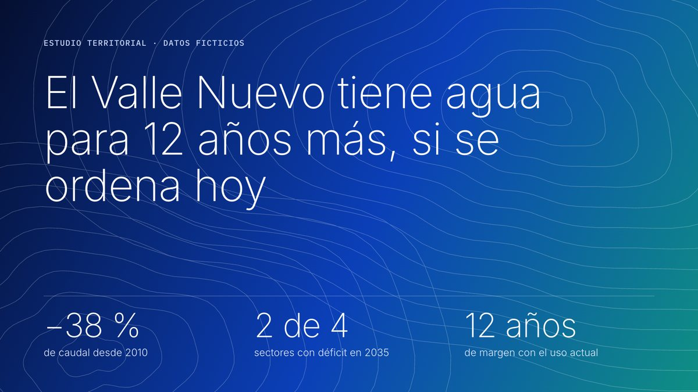<br><sub><b>Estudio técnico</b> · sobrio y corporativo</sub></td>
<td width="50%">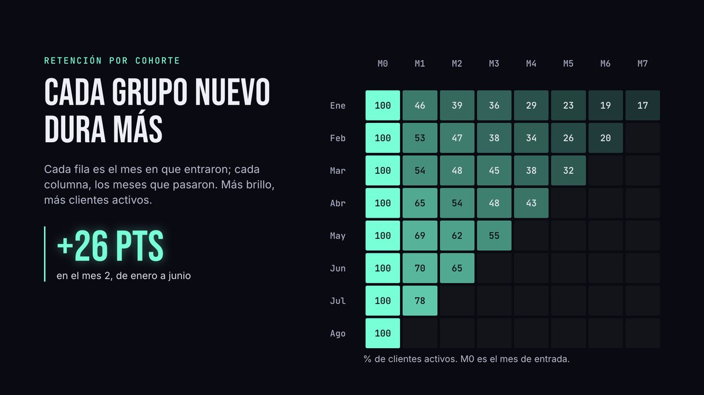<br><sub><b>Datos de producto</b> · oscuro, con neón sutil</sub></td>
</tr>
<tr>
<td>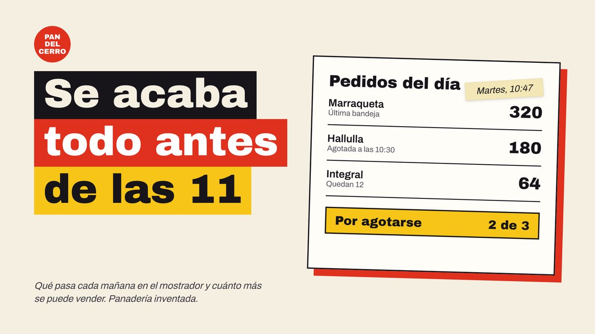<br><sub><b>Negocio de barrio</b> · cartel y mucha personalidad</sub></td>
<td>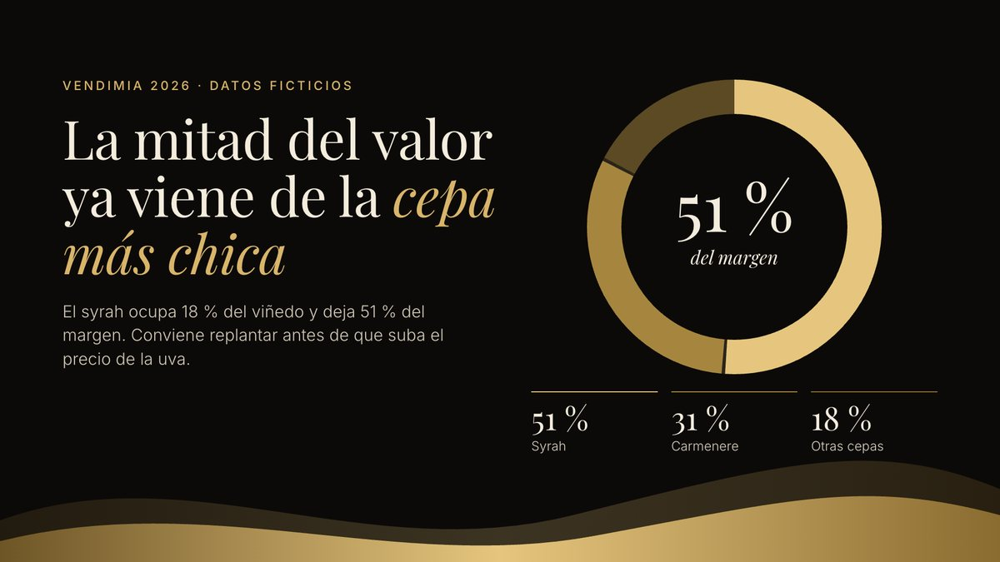<br><sub><b>Marca premium</b> · negro y dorado</sub></td>
</tr>
<tr>
<td>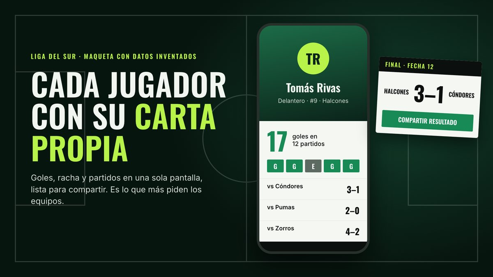<br><sub><b>Maqueta de una app</b> · pantallas dibujadas para mostrar la idea</sub></td>
<td>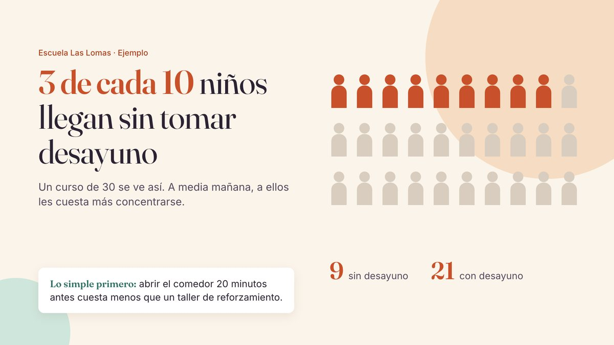<br><sub><b>Para cualquier persona</b> · lenguaje simple y pictogramas</sub></td>
</tr>
<tr>
<td>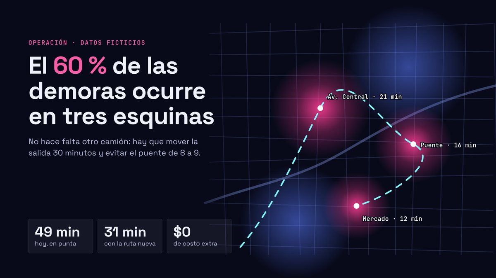<br><sub><b>Operación</b> · mapa con la ruta animada</sub></td>
<td>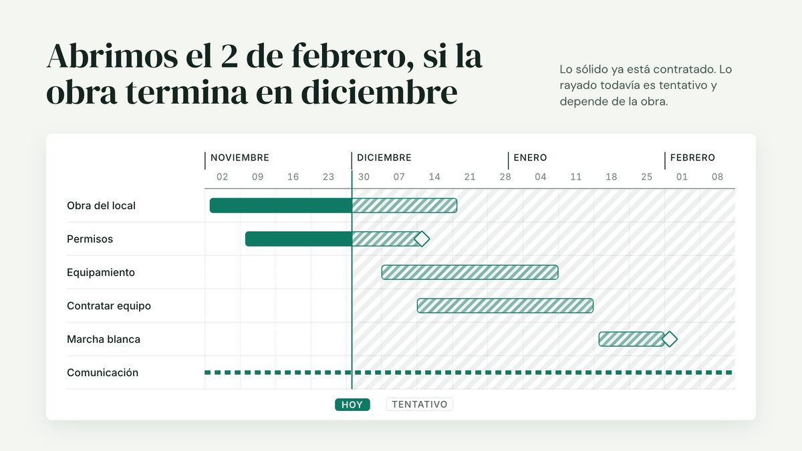<br><sub><b>Planificación</b> · cronograma con lo tentativo a la vista</sub></td>
</tr>
</table>

## Informes

Para leer con calma: una sola página, con la conclusión arriba, índice al costado y gráficos. Se pueden compartir como archivo o imprimir en PDF. Hay distintos tipos según lo que necesites:

<table>
<tr>
<td width="50%">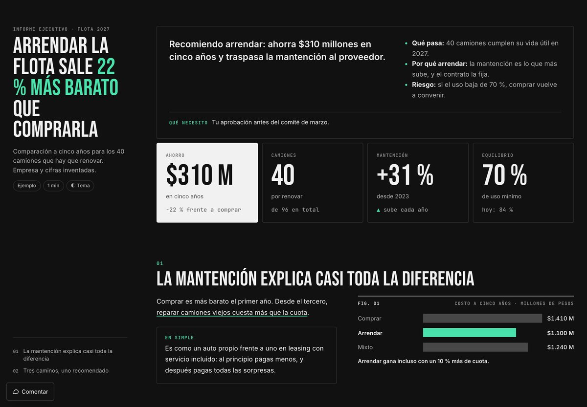<br><sub><b>Para decidir</b> · recomendación, cifras, opciones y qué se necesita de quien lee</sub></td>
<td width="50%">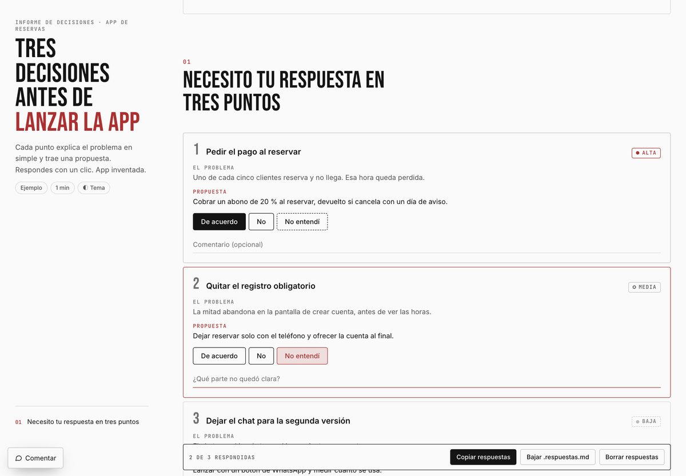<br><sub><b>Punto por punto</b> · quien lee responde con botones y copia sus respuestas</sub></td>
</tr>
<tr>
<td>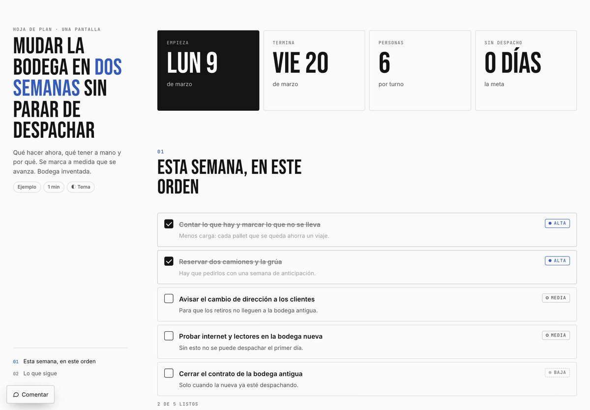<br><sub><b>Hoja de plan</b> · pasos que se marcan, con prioridad; el avance queda guardado</sub></td>
<td>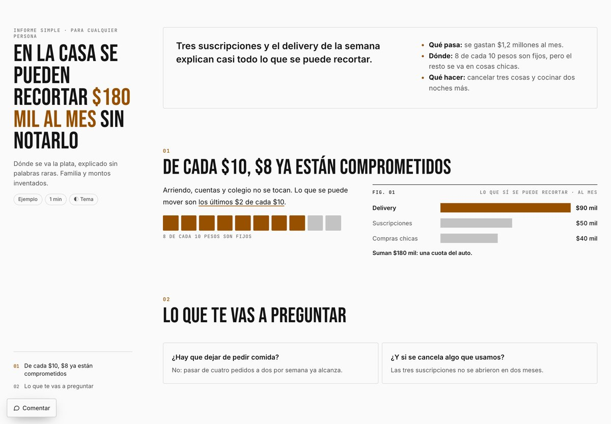<br><sub><b>En simple</b> · sin jerga, con ejemplos y las preguntas que cualquiera haría</sub></td>
</tr>
<tr>
<td>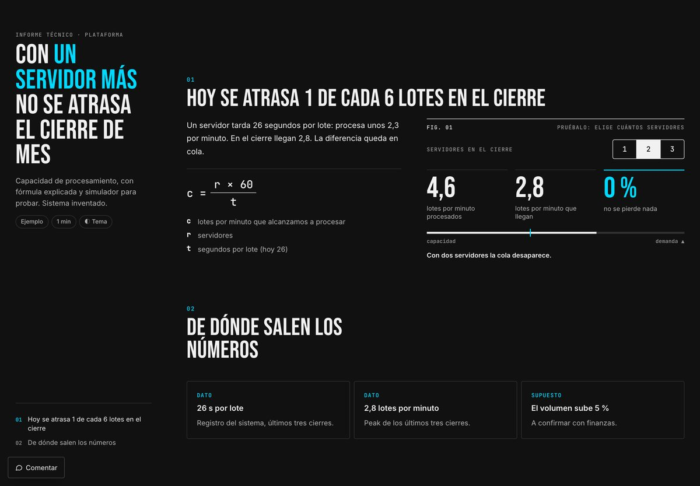<br><sub><b>Técnico</b> · fórmula explicada, simulador para probar y fuentes marcadas</sub></td>
<td>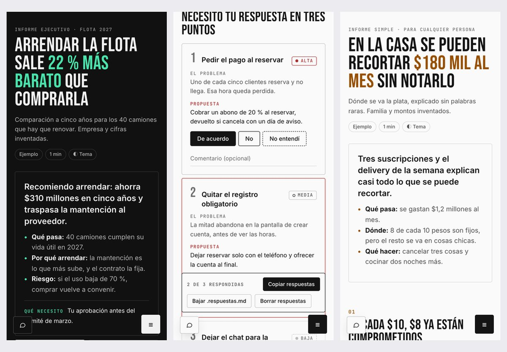<br><sub><b>En el celular</b> · todos se leen bien, sin hacer zoom</sub></td>
</tr>
</table>

Se piden así:

| Necesitas | Pídelo así |
|---|---|
| Que alguien apruebe algo | "Hazme un informe ejecutivo para que gerencia decida si arrendar o comprar." |
| Respuestas a varios puntos | "Hazme un informe de decisiones con estos hallazgos: que respondan punto por punto." |
| Ordenar lo que hay que hacer | "Hazme una hoja de plan de una pantalla para la mudanza, con pasos que se puedan marcar." |
| Explicarle algo a quien no sabe | "Explícalo simple, para alguien que no sabe de números." |
| Que puedan probar con sus números | "Hazme un informe técnico con la fórmula explicada y un simulador." |

## El narrador

Una voz presenta el documento sola, sin que nadie lo exponga. Es como un video, pero sigue siendo tu presentación: la puedes pausar, saltar de lámina o apagar la voz y seguir a mano.

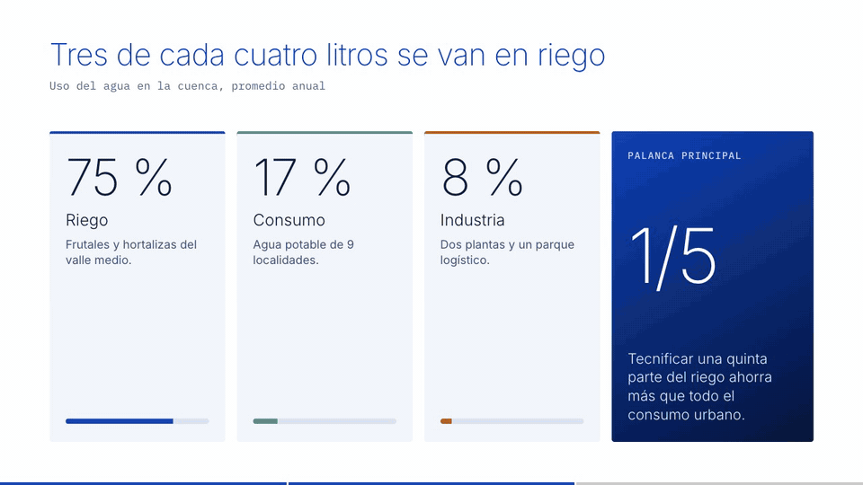

<sub>Aquí sin sonido, porque es un GIF. En el archivo real se escucha la voz.</sub>

- **Resalta lo que nombra.** Mientras habla, enmarca cada dato justo en ese momento y atenúa el resto.
- **Subtítulos palabra por palabra**, y avanza de lámina solo.
- **Parte apagado.** Quien abre el archivo ve una presentación normal; con la tecla `N` se enciende.
- **Gratis y sin cuentas.** Usa las voces de Microsoft Edge. Necesita internet solo al generar la voz: el audio queda dentro del HTML y después funciona sin conexión.
- **Voces:** Catalina (Chile) por defecto y Jorge (México) si la pides. También sirve cualquier otra voz de Edge, en otros idiomas.

Sirve cuando alguien va a verlo sin presentador (un avance para gerencia, explicar un proyecto a alguien nuevo) o para **ensayar**: escuchas cómo se podría contar antes de exponerlo tú. Solo pídelo:

```text
Hazme una presentación narrada, con voz, que explique cómo funciona este proyecto a alguien que no lo conoce.
```

## El menú de la derecha

Toda presentación trae un panel de opciones. Se abre con la tecla `O`, con la rueda de arriba a la derecha o llevando el mouse a la orilla derecha.

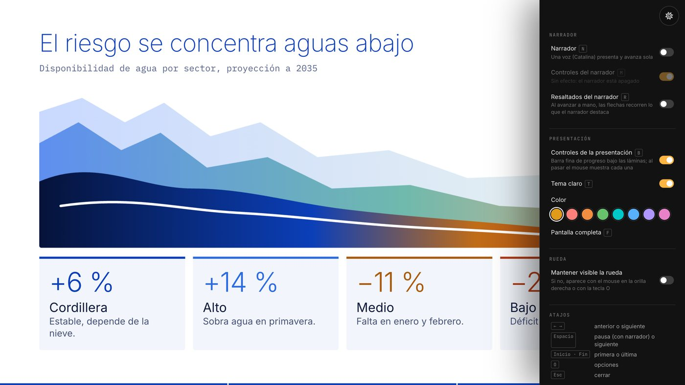

| En el menú | Qué hace | Tecla |
|---|---|---|
| **Narrador** | enciende la voz | `N` |
| **Controles del narrador** | muestra u oculta su barra: pausa, avance y subtítulos | `M` |
| **Resaltados del narrador** | sin voz, las flechas recorren lo que el narrador destacaría | `R` |
| **Controles de la presentación** | barra fina de avance, con miniaturas | `B` |
| **Tema** | claro u oscuro | `T` |
| **Color** | cambia el color de acento | |
| **Pantalla completa** | para exponer | `F` |
| **Mantener visible la rueda** | deja la rueda siempre a la vista | |
| **Comentar** | deja notas sobre lo que ves | `C` |

Y para moverse, `←` `→` o espacio. Lo que cambies queda recordado en tu navegador.

<table>
<tr>
<td width="50%">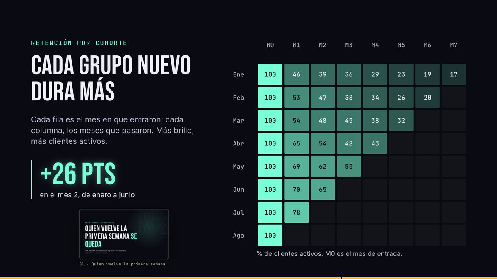<br><sub><b>Barra de avance</b> · al pasar el mouse muestra cada lámina; con un clic saltas a ella</sub></td>
<td width="50%">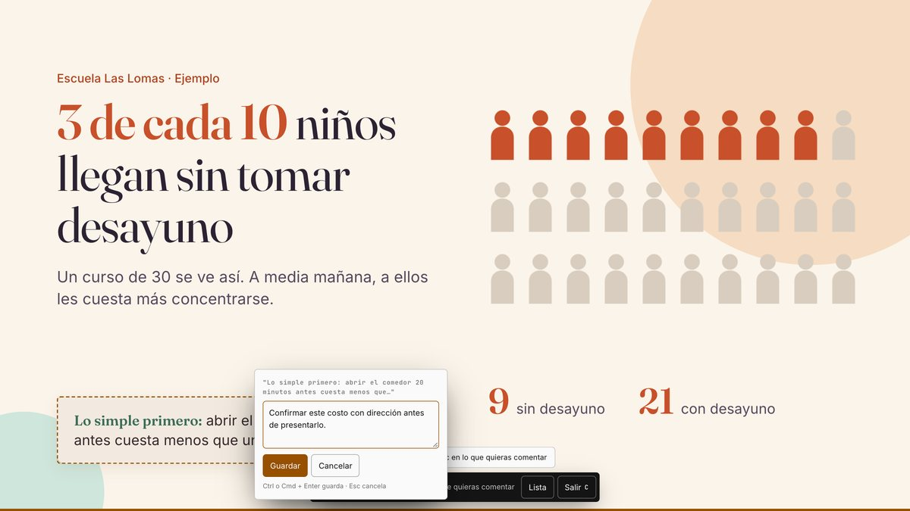<br><sub><b>Modo comentar</b> · haz clic en lo que quieres cambiar, anota y pega los comentarios en el chat</sub></td>
</tr>
</table>

## Instalar

Copia este mensaje y pégalo en tu agente. Él hace el resto:

```text
Instala la skill "designdocs": clona https://github.com/Inverosimil/designdocs en la carpeta de skills de este agente (Claude Code: ~/.claude/skills/designdocs, Codex: ~/.agents/skills/designdocs; en Windows, dentro de tu carpeta de usuario). Léela (SKILL.md) y corre `node scripts/doctor.mjs` para ver qué me falta. Instala lo que falte pidiéndome permiso antes de cada cosa: Node 22 o más nuevo y Chrome o Edge (para revisar el resultado y sacar PDF y PowerPoint), Python 3 (para empaquetar en un solo archivo y para la voz) y, opcional, ffmpeg (videos) y d2 (diagramas). Las plantillas, tipografías y el kit de marca ya vienen dentro de la skill: no descargues ningún design system aparte. Cuando termines, dime qué quedó listo y qué no.
```

¿Usas Claude en el chat, sin terminal? Baja `designdocs-chat.zip` desde [Releases](https://github.com/Inverosimil/designdocs/releases) y súbelo en **Personalizar > Skills**. Es más liviana: no exporta a PowerPoint y puede que no pueda revisar con capturas; el agente te avisa.

## Usar

Pídelo como a una persona:

```text
Arma una presentación de 8 láminas para proponer la segunda etapa del proyecto. Te paso las notas de la reunión; tienen que aprobar el plazo.
```

```text
Hazme un informe corto con esta planilla de gastos. Que lo entienda alguien que no sabe de números.
```

**Para corregir,** escríbelo en el chat o abre el archivo, presiona `C`, haz clic en lo que quieres cambiar y anota. Después copias los comentarios y los pegas en el chat.

## Más

- [GUIA.md](GUIA.md): instalación paso a paso, requisitos y exportar a PDF y PowerPoint.
- [SKILL.md](SKILL.md): el proceso completo que sigue el agente.
- [LICENCIAS.md](LICENCIAS.md): fuentes e íconos incluidos.
